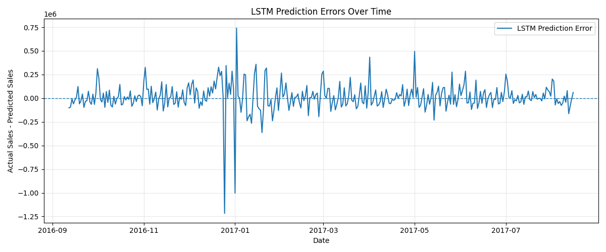
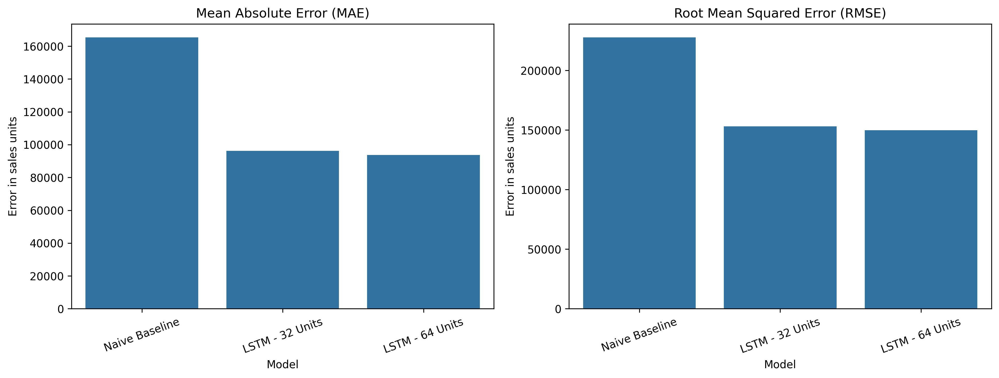

# Predictive Analytics on Retail Sales: Time Series Forecasting with LSTM

## 📌 Project Overview

This project explores historical retail sales data and develops a time-series forecasting workflow using **Long Short-Term Memory (LSTM)** neural networks. LSTMs are a type of recurrent neural network designed to learn patterns from sequential data.

The project uses the **Kaggle Store Sales – Time Series Forecasting** dataset, based on retail sales from Corporación Favorita in Ecuador. The workflow covers exploratory data analysis (EDA), time-series preprocessing, baseline forecasting, LSTM model development, model evaluation, results visualisation, and project documentation.

The work is organised into four Jupyter notebooks. It includes six EDA visualisations, a prepared daily sales series, a naive baseline, two LSTM configurations, forecast comparisons, prediction-error analysis, and a model-performance comparison chart.

This is a practical learning and portfolio project focused on time-series analysis, deep learning, and predictive analytics.

## 🎯 Objectives

- Explore historical retail sales data and identify trends and recurring patterns.
- Inspect dataset structure, data types, missing values, and data coverage.
- Analyse sales distributions and historical trends through visualisations.
- Investigate weekly sales patterns and compare sales across stores and product families.
- Explore the relationship between holiday/event dates and daily sales.
- Prepare time-series data for forecasting while preserving chronological order and avoiding data leakage.
- Establish a naive baseline for comparison.
- Develop and train LSTM models using a 30-day lookback window.
- Evaluate forecasts using Mean Absolute Error (MAE) and Root Mean Squared Error (RMSE).
- Visualise actual and predicted sales, model performance, and prediction errors.
- Document findings, assumptions, limitations, and instructions for reproducing the work.

## 📂 Dataset

The project uses the [Store Sales – Time Series Forecasting dataset on Kaggle](https://www.kaggle.com/competitions/store-sales-time-series-forecasting), based on sales data from Corporación Favorita in Ecuador.

The dataset files used or collected for this project include:

| File                  | Description                                                                           |
| --------------------- | ------------------------------------------------------------------------------------- |
| `train.csv`           | Historical sales observations used for EDA and model development.                     |
| `stores.csv`          | Store metadata, including store characteristics and location.                         |
| `oil.csv`             | Daily oil price information.                                                          |
| `holidays_events.csv` | Holiday and event information used to investigate calendar effects and missing dates. |
| `transactions.csv`    | Daily transaction counts for individual stores.                                       |

Additional competition files, such as `test.csv` and `sample_submission.csv`, are not required for the current aggregated daily-series experiment but could be used in a future competition-style forecasting extension.

### Initial dataset overview

The initial exploration of `train.csv` identified:

- **Rows:** 3,000,888
- **Columns:** 6
- **Date coverage:** 1 January 2013 – 15 August 2017
- **Unique stores:** 54
- **Product families:** 33
- **Missing values:** None found in the six columns examined

The six columns are `id`, `date`, `store_nbr`, `family`, `sales`, and `onpromotion`.

**Data access:** Raw CSV files should be placed in the local `datasets/` directory. They are excluded from Git tracking to keep the repository lightweight. Download the files from the [Kaggle competition data page](https://www.kaggle.com/competitions/store-sales-time-series-forecasting/data).

## 🛠️ Technology Stack

- **Python** — primary programming language.
- **Pandas** — data loading, manipulation, and analysis.
- **NumPy** — numerical computing.
- **Matplotlib** — charts and visualisation.
- **Seaborn** — model comparison charts.
- **Jupyter Notebook / IPykernel** — interactive analysis and documentation.
- **Scikit-learn** — scaling and regression evaluation metrics.
- **TensorFlow/Keras** — LSTM model development and training.

## 🗺️ Project Workflow

### Task 1: Project Setup & Exploratory Data Analysis — Completed

The dataset was loaded and inspected for structure, data types, missing values, date coverage, and descriptive statistics. Six visualisations explored sales distribution, daily trends, weekly patterns, store performance, product families, and holiday/event comparisons.

### Task 2: Data Preprocessing & Time Series Preparation — Completed

Sales were aggregated across all stores and product families into one daily total. Date continuity was checked, four missing calendar dates were investigated using the holiday/event data, and a continuous daily series was created and exported to `outputs/processed/daily_sales.csv`.

The four missing dates were 25 December 2013, 2014, 2015, and 2016. They coincide with national Christmas holidays in the holiday calendar and were provisionally filled with zero sales. These are assumed values, not observed sales, and may affect training and evaluation.

### Task 3: LSTM Model Development & Training — Completed

The modelling notebook creates sequences from the previous **30 days** to predict the following day's sales. The data is split chronologically into training, validation, and test periods. The MinMaxScaler is fitted on the model-training period only and reused for later periods.

A naive baseline assumes the next day's sales will equal the latest available actual sales. A 32-unit LSTM with dropout and early stopping was trained, and a 64-unit LSTM was trained as an alternative configuration.

### Task 4: Model Evaluation & Optimisation — Completed

The naive baseline and both LSTM configurations were compared on the same 338-observation test period using MAE and RMSE. Prediction-error summaries and a residual plot were also produced.

The reported evaluation uses **rolling one-day-ahead forecasting**: the previous day's actual sales are available when predicting the next day. It is not a multi-day forecast generated entirely in advance.

### Task 5: Results Visualisation & Project Delivery — Completed

The fourth notebook presents the model comparison table and chart, key findings, limitations, and conclusion. The final comparison chart is saved as `outputs/figures/11_model_performance_comparison.png`. The README documents the complete workflow, figures, results, limitations, project structure, and instructions for running the notebooks.

## 📊 Exploratory Data Analysis

The EDA was conducted in `notebooks/01_exploratory_data_analysis.ipynb`. The six figures are stored in `outputs/figures/`.

### 1. Sales Distribution


The sales distribution is strongly right-skewed. The mean sales value is approximately **357.78**, while the median is **11**. Many observations have relatively low sales values, while a smaller number have much higher values. These high values should be investigated in context rather than automatically removed as outliers.

### 2. Daily Sales Trend


Aggregated daily sales fluctuate over time and show an overall upward pattern. This motivates further investigation into long-term trends, calendar effects, and other variables that may be useful for forecasting.

### 3. Weekly Sales Patterns


The weekday comparison suggests that Saturday and Sunday have relatively high aggregated sales, while Thursday is lower in the current analysis. This is a descriptive pattern in this dataset and does not establish its cause.

### 4. Top-Performing Stores


The store comparison shows differences in cumulative sales across locations. Store 44 is the leading store among the top stores shown in the analysis. These totals should be interpreted alongside the period covered and the available store-level data.

### 5. Top Product Families


GROCERY I, BEVERAGES, and PRODUCE are the leading product families by total sales in the initial analysis. This provides a starting point for investigating differences in sales behaviour across product categories.

### 6. Holiday and Event Sales Comparison


The preliminary comparison shows average daily sales of approximately **694,431** on dates marked as holidays or events, compared with approximately **627,548** on other dates.

This difference is descriptive, not evidence that holidays cause higher sales. The comparison does not, by itself, control for store closures, event types, seasonal trends, or other influences.

## 📈 Initial EDA Findings

- The training dataset contains more than three million observations, making efficient data handling important.
- No missing values were found in the six columns of `train.csv` during the initial inspection.
- Sales values are strongly right-skewed.
- Historical daily sales fluctuate and show an overall upward pattern.
- Sales differ across weekdays, stores, and product families.
- Average sales are higher on dates marked as holidays/events in the preliminary comparison, but further analysis is required before drawing stronger conclusions.

These findings guide the modelling workflow but do not establish in advance which modelling approach will perform best.

## 🧹 Data Preprocessing & Time Series Preparation

The preprocessing work was carried out in `notebooks/02_data_preprocessing.ipynb`.

### Prepared daily sales series

Sales were aggregated across all stores and product families to create one total sales value per calendar day, covering **1 January 2013 to 15 August 2017**.

- **Rows:** 1,688 daily observations
- **Columns:** `date`, `daily_sales`
- **Missing calendar dates found:** 4
- **Missing values after calendar completion:** 0
- **Duplicate dates:** 0
- **Chronological order:** Confirmed
- **Daily intervals:** Consistent

The four missing dates were 25 December 2013, 2014, 2015, and 2016. Each matched a national Christmas holiday in `holidays_events.csv`. These dates were provisionally filled with zero sales to create a continuous calendar. This is an assumption rather than an observed sales value and should be reconsidered if the project is extended.

The exported CSV was reloaded and checked. Dates matched exactly, and sales values matched within floating-point tolerance.

### Prepared daily sales plot


The plot provides a visual check of the prepared series, including its overall trend and day-to-day fluctuations. The zero-valued Christmas dates appear as sharp dips and should be interpreted in light of the documented assumption.

## 🧠 LSTM Model Development

The model-development notebook is `notebooks/03_lstm_model_development.ipynb`.

- **Forecast target:** total daily sales aggregated across stores and product families.
- **Lookback window:** 30 previous days.
- **Baseline:** naive one-day-ahead forecast using the latest available actual sales.
- **Primary model:** LSTM with 32 units, dropout, and a dense output layer.
- **Alternative model:** LSTM with 64 units, dropout, and a dense output layer.
- **Training controls:** chronological validation period and early stopping based on validation loss.
- **Scaling:** MinMaxScaler fitted on the model-training period only.
- **Evaluation:** the same held-out test dates for each model.

### Training and validation loss


The loss curves show training and validation performance across epochs. Validation loss was used for early stopping and restoring the best weights.

### Actual sales vs. forecasts


This plot compares actual test-period sales with the naive baseline and LSTM predictions. Sharp dips around Christmas reflect the provisional zero values in the prepared series.

## 📊 Model Evaluation & Optimisation

The final reported comparison uses the same **338 test observations** for each model.

| Model           |           MAE |           RMSE |
| --------------- | ------------: | -------------: |
| Naive baseline  |    165,347.39 |     227,751.17 |
| LSTM — 32 units |     96,164.54 |     153,011.12 |
| LSTM — 64 units | **93,789.06** | **149,901.76** |

**Metric definitions**

- **MAE (Mean Absolute Error):** the average absolute difference between actual and predicted sales.
- **RMSE (Root Mean Squared Error):** a metric that gives greater weight to larger prediction errors.
- **Baseline comparison:** shows whether the LSTM improves on a simple forecasting approach.

Compared with the naive baseline, the 64-unit LSTM reduced test MAE by approximately **43.3%** and RMSE by approximately **34.2%**. In this reported test comparison, the 64-unit model has the lowest MAE and RMSE. The 32-unit model had slightly better best validation loss, so model choice should consider validation performance as well as test metrics.

These values are the recorded results used in the Task 5 comparison notebook. If the evaluation is rerun and produces different metrics, update this table and the Task 5 chart together so the repository reports one consistent run.

### Prediction-error analysis



Prediction errors were examined using mean error, median absolute error, the 90th percentile absolute error, and maximum absolute error. Positive residuals mean actual sales were higher than predicted; negative residuals mean the model predicted more sales than actually occurred.

### Model performance comparison



The comparison chart presents MAE and RMSE for the naive baseline and both LSTM configurations. Lower values indicate smaller errors on this test period.

### Interpretation

Both LSTM configurations outperform the naive baseline on the reported MAE and RMSE metrics. The 64-unit LSTM has the lowest test errors in this comparison, while the 32-unit model has slightly better best validation loss. The result suggests that the LSTM models captured useful patterns in the aggregated daily series, but performance should not be assumed to generalise to other periods without further testing.

## ⚠️ Limitations

- **Aggregated target:** sales from all stores and product families are combined into a single daily series. The project does not evaluate store-level or product-family-level forecasts.
- **Assumed zero sales:** four missing Christmas dates were filled with zero sales. These are not observed values and may affect model training, plots, and evaluation.
- **Rolling one-day-ahead setup:** each next-day prediction assumes the previous day's actual sales are available. This differs from predicting a long future horizon without new actual observations.
- **Limited model comparison:** only a naive baseline and two LSTM configurations are compared. Other statistical and machine-learning forecasting methods have not been comprehensively tested.
- **Historical test period:** the metrics describe one held-out period and do not guarantee future performance.
- **Calendar and external features:** although additional competition files are available, the current forecasting target is based on the aggregated sales series rather than a multivariate model using all possible external predictors.
- **Model selection:** the 64-unit model has the best reported test metrics, while the 32-unit model has slightly better validation loss. Further validation across time periods would provide a stronger basis for choosing a final production model.

## 📁 Project Structure

```text
retail-sales-lstm-forecasting/
├── datasets/
├── notebooks/
│   ├── 01_exploratory_data_analysis.ipynb
│   ├── 02_data_preprocessing.ipynb
│   ├── 03_lstm_model_development.ipynb
│   └── 04_results_visualisation.ipynb
├── outputs/
│   ├── figures/
│   │   ├── 01_sales_distribution.png
│   │   ├── 02_daily_sales_trend.png
│   │   ├── 03_weekly_sales_patterns.png
│   │   ├── 04_top_stores.png
│   │   ├── 05_top_product_families.png
│   │   ├── 06_holiday_sales_comparison.png
│   │   ├── 07_daily_sales_plot.png
│   │   ├── 08_lstm_training_validation_loss.png
│   │   ├── 09_actual_vs_predicted_sales.png
│   │   ├── 10_lstm_prediction_errors.png
│   │   └── 11_model_performance_comparison.png
│   └── processed/
│       └── daily_sales.csv
├── CHANGE_LOG.md
├── README.md
├── requirements.txt
└── SUMMARY.md
```

The `outputs/figures/` directory is intended to be tracked so the visualisations are available in the repository. Raw CSV files under `datasets/` are excluded from Git tracking.

## ▶️ How to Run the Project

### 1. Clone or download the repository

```bash
git clone <your-repository-url>
cd retail-sales-lstm-forecasting
```

Replace `<your-repository-url>` with the actual GitHub repository URL.

### 2. Create and activate a virtual environment (recommended)

```bash
python -m venv .venv
```

Windows PowerShell:

```powershell
.\.venv\Scripts\Activate.ps1
```

macOS/Linux:

```bash
source .venv/bin/activate
```

### 3. Install dependencies

```bash
pip install -r requirements.txt
```

### 4. Add the dataset

Download the required Kaggle CSV files and place them in `datasets/`. The raw files are not included in the repository.

### 5. Run the notebooks in order

Open the project in Jupyter or VS Code and run:

1. `notebooks/01_exploratory_data_analysis.ipynb`
2. `notebooks/02_data_preprocessing.ipynb`
3. `notebooks/03_lstm_model_development.ipynb`
4. `notebooks/04_results_visualisation.ipynb`

Run the earlier notebooks first so the processed daily series and figures required by later notebooks are available. TensorFlow installation and model training time may vary by operating system and Python version.

## ✅ Project Status

**Project workflow: Completed — Tasks 1–5.**

The project documentation reflects the four-notebook workflow and the provided project structure. The project includes EDA, preprocessing, LSTM development, model evaluation, results visualisation, documented findings, and known limitations.

- [x] Project repository structure documented.
- [x] Exploratory data analysis completed and documented.
- [x] Six EDA visualisations documented.
- [x] Daily sales preprocessing and continuous time series documented.
- [x] Missing Christmas-date assumption documented.
- [x] Naive baseline forecasting documented.
- [x] 32-unit and 64-unit LSTM configurations documented.
- [x] MAE and RMSE model comparison documented.
- [x] Training/validation loss and actual-versus-predicted plots documented.
- [x] Prediction-error analysis documented.
- [x] Model performance comparison chart documented.
- [x] Limitations and interpretation documented.
- [x] Four notebooks listed in the project structure.
- [x] All eleven figure paths listed in the project structure.
- [x] Processed daily-sales output listed in the project structure.
- [x] Environment setup and notebook run order documented.
- [x] References included.

## 🔮 Conclusion

This project demonstrates an end-to-end retail sales forecasting workflow, from exploratory analysis and daily time-series preparation to baseline forecasting, LSTM training, evaluation, and visualisation. In the reported test period, both LSTM configurations outperform the naive baseline on MAE and RMSE, with the 64-unit model achieving the lowest test errors. The findings should be interpreted alongside the rolling one-day-ahead evaluation design and the four provisionally zero-filled Christmas dates.

## 🔗 References

- [Kaggle: Store Sales – Time Series Forecasting](https://www.kaggle.com/competitions/store-sales-time-series-forecasting)
- [Kaggle: Competition Data](https://www.kaggle.com/competitions/store-sales-time-series-forecasting/data)
- [Pandas Documentation](https://pandas.pydata.org/docs/)
- [NumPy Documentation](https://numpy.org/doc/)
- [Matplotlib Documentation](https://matplotlib.org/stable/)
- [Seaborn Documentation](https://seaborn.pydata.org/)
- [TensorFlow Documentation](https://www.tensorflow.org/)
- [Scikit-learn Documentation](https://scikit-learn.org/stable/)

---
