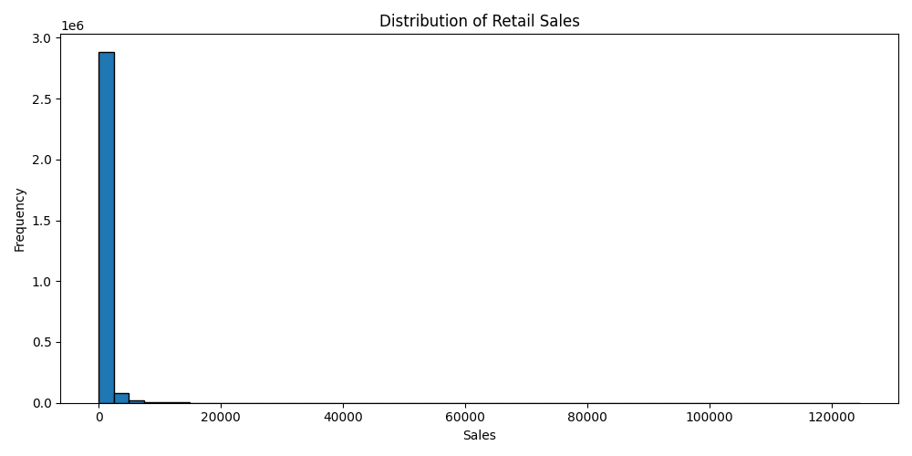
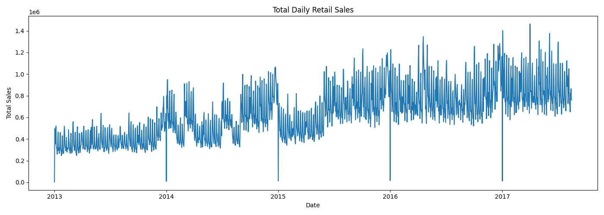
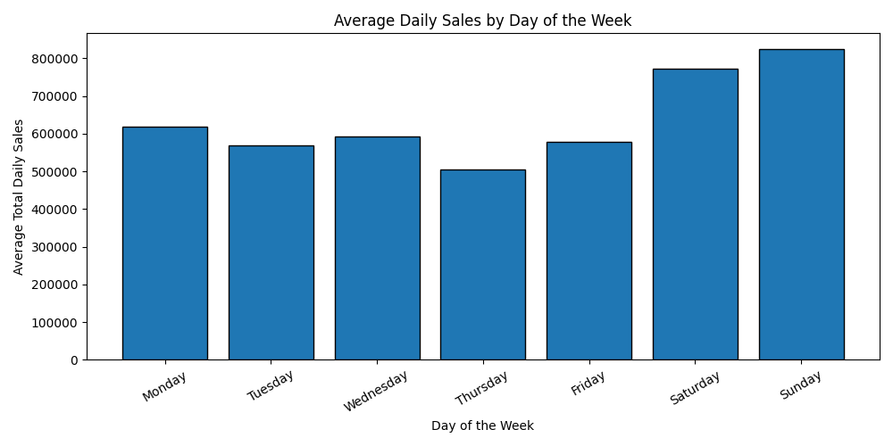
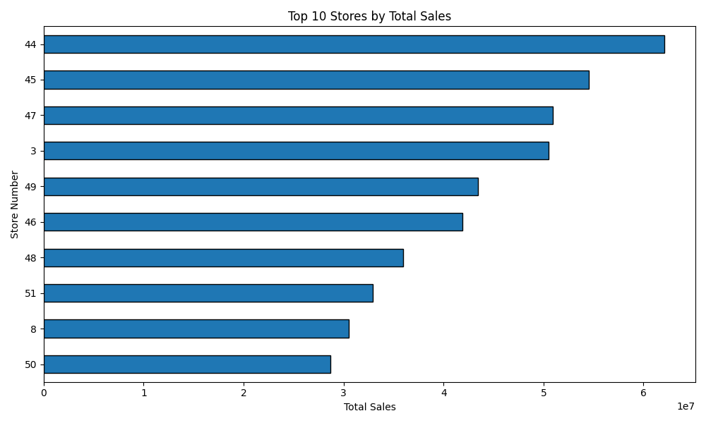
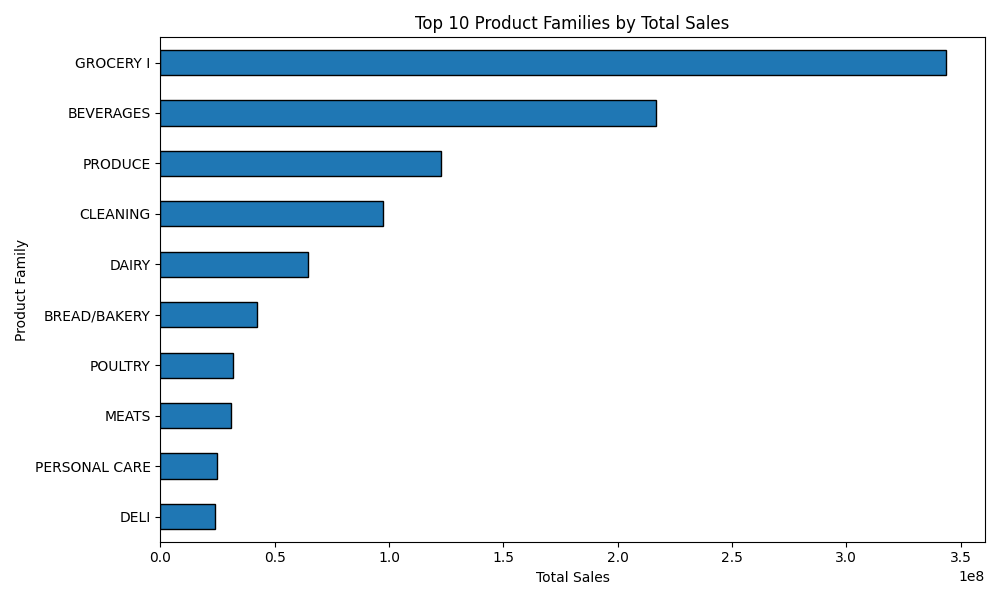
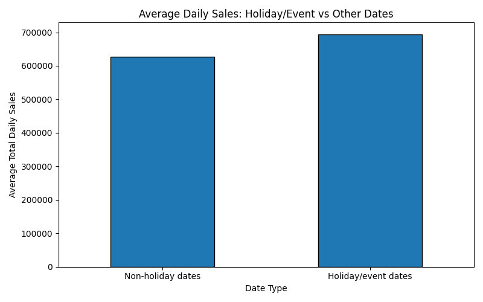

# Predictive Analytics on Retail Sales: Time Series Forecasting with LSTM

## 📌 Project Overview

This project explores historical retail sales data and aims to forecast future sales using **Long Short-Term Memory (LSTM)** neural networks, a type of recurrent neural network designed to learn patterns in sequential data.

The project uses the **Kaggle Store Sales – Time Series Forecasting** dataset, based on retail sales from Corporación Favorita in Ecuador. It follows a structured workflow, beginning with exploratory data analysis (EDA), followed by time series preparation, baseline forecasting, LSTM model development, and performance evaluation.

The initial EDA stage has been completed using Python, Pandas, NumPy, and Matplotlib. The analysis examines sales distributions, historical trends, weekly patterns, store and product-family performance, and sales on holiday or event dates.

The project is being developed as a practical learning and portfolio project in time series analysis, deep learning, and predictive analytics.

## 🎯 Objectives

- Explore historical retail sales data and identify trends and recurring patterns.
- Inspect dataset structure, data types, missing values, and data coverage.
- Analyse sales distributions and historical trends through visualisations.
- Investigate weekly sales patterns and compare sales across stores and product families.
- Explore the relationship between holiday/event dates and daily sales.
- Prepare time series data for forecasting without introducing data leakage.
- Establish a baseline forecasting approach for comparison.
- Develop and train an LSTM neural network to forecast future sales.
- Evaluate forecasting performance using appropriate regression metrics.
- Visualise actual and predicted sales and interpret the results.

## 📂 Dataset

The project uses the **Store Sales – Time Series Forecasting** dataset from Kaggle, based on retail sales data from Corporación Favorita in Ecuador.

The following dataset files have been collected for this project:

| File                  | Description                                                            |
| --------------------- | ---------------------------------------------------------------------- |
| `train.csv`           | Historical sales observations used for analysis and model development. |
| `stores.csv`          | Store metadata, including store characteristics and location.          |
| `oil.csv`             | Daily oil price information.                                           |
| `holidays_events.csv` | Holiday and event information that may be relevant to sales patterns.  |
| `transactions.csv`    | Daily transaction counts for individual stores.                        |

Additional competition files, such as `test.csv` and `sample_submission.csv`, may be incorporated later if needed for competition-style forecasting.

**Initial dataset overview**

The exploratory analysis of `train.csv` identified the following:

- **Rows:** 3,000,888
- **Columns:** 6
- **Date coverage:** 1 January 2013 – 15 August 2017
- **Unique stores:** 54
- **Product families:** 33
- **Missing values:** None found in the six columns examined

The columns are `id`, `date`, `store_nbr`, `family`, `sales`, and `onpromotion`.

**Important:** Raw CSV files are stored locally in the `datasets/` directory and excluded from Git tracking to keep the repository lightweight. Download the data from the [Kaggle competition data page](https://www.kaggle.com/competitions/store-sales-time-series-forecasting/data).

## 🛠️ Technology Stack

The project currently uses:

- **Python** — primary programming language.
- **Pandas** — data loading, manipulation, and analysis.
- **NumPy** — numerical computing.
- **Matplotlib** — data visualisation.
- **Jupyter Notebook** — interactive analysis and documentation.

The planned modelling stage may additionally use:

- **Scikit-learn** — preprocessing and evaluation metrics.
- **TensorFlow/Keras** — LSTM model development and training.

Dependencies will be updated as new libraries are introduced into the implementation.

## 🗺️ Project Workflow

The project is organised into five main tasks.

### Task 1: Project Setup & Exploratory Data Analysis — Completed

Established the project structure, loaded the dataset, inspected its structure and data quality, calculated descriptive statistics, and explored sales patterns through visualisations.

The analysis includes sales distribution, daily trends, weekly patterns, top-performing stores, top product families, and a preliminary comparison of holiday/event dates with other dates.

### Task 2: Data Preprocessing & Time Series Preparation — Pending

Prepare the data for forecasting, investigate relevant variables and potential data-quality issues, define the forecasting target and horizon, and create chronological training, validation, and test splits without data leakage.

### Task 3: LSTM Model Development & Training — Pending

Prepare sequential input windows, establish a baseline forecast, design an LSTM neural network, and train the model to predict future retail sales.

### Task 4: Model Evaluation & Optimisation — Pending

Evaluate forecasting performance using suitable metrics, compare the LSTM against the baseline, analyse prediction errors, and refine the model where justified.

### Task 5: Results Visualisation & Project Delivery — Pending

Visualise forecasts and prediction errors, interpret the results in a retail context, document limitations, and organise the project for reproducibility and portfolio presentation.

## 📊 Exploratory Data Analysis

The initial EDA was conducted in `notebooks/01_exploratory_data_analysis.ipynb`. The following visualisations were generated and saved in `outputs/figures/`.

### 1. Sales Distribution



The sales distribution is strongly right-skewed: the mean sales value is approximately **357.78**, while the median is **11**. This indicates that many observations have relatively low sales values, while a smaller number have much higher values. These observations should be investigated in context rather than automatically removed as outliers.

### 2. Daily Sales Trend



Daily aggregated sales show changes over time, including an overall upward pattern and noticeable fluctuations. These patterns motivate further investigation into long-term trends, calendar effects, and other variables that may be useful for forecasting.

### 3. Weekly Sales Patterns



The weekday comparison suggests that Saturday and Sunday have relatively high aggregated sales, while Thursday is lower in the current analysis. This is an initial pattern to investigate further during time series preparation.

### 4. Top-Performing Stores



The comparison of stores by cumulative sales highlights differences in total sales across locations. Store 44 is the leading store among the top stores shown in the analysis. These totals should be interpreted alongside the time period and available store-level data.

### 5. Top Product Families



GROCERY I, BEVERAGES, and PRODUCE are the leading product families by total sales in the initial analysis. This provides a starting point for investigating differences in sales behaviour across product categories.

### 6. Holiday and Event Sales Comparison



The preliminary comparison shows average daily sales of approximately **694,431** on dates marked as holidays or events, compared with approximately **627,548** on other dates.

This difference is descriptive, not evidence that holidays cause higher sales. The comparison groups dates using the available holiday/event calendar and does not, by itself, control for store closures, event types, seasonal trends, or other influences.

## 📈 Initial Findings

The completed EDA provides several useful starting points for the modelling stage:

- The training dataset contains more than three million observations, making efficient data handling important.
- No missing values were found in the six columns of `train.csv` during the initial inspection.
- Sales values are strongly right-skewed, so the distribution and high-value observations need careful consideration.
- Historical daily sales fluctuate and show an overall upward pattern.
- Sales differ across weekdays, stores, and product families.
- Daily sales on dates marked as holidays or events are higher on average in the preliminary comparison, but further analysis is needed before drawing stronger conclusions.

These findings guide the next stage of investigation. They do not yet establish which variables or modelling approach will produce the best forecasts.

## 📊 Evaluation Strategy

Model performance will be assessed using suitable forecasting metrics, including:

- **MAE (Mean Absolute Error):** measures the average absolute difference between actual and predicted sales.
- **RMSE (Root Mean Squared Error):** gives greater weight to larger prediction errors.
- **Baseline comparison:** determines whether the LSTM improves on a simpler forecasting approach.

The forecasting horizon, target granularity, validation strategy, and final metrics will be defined during the preprocessing and modelling stages. Results will be documented after the models have been trained and evaluated.

## 📁 Project Structure

```text
retail-sales-lstm-forecasting/
├── datasets/
│   └── *.csv                         # Local raw datasets; excluded from Git
├── notebooks/
│   └── 01_exploratory_data_analysis.ipynb
├── outputs/
│   └── figures/
│       ├── 01_sales_distribution.png
│       ├── 02_daily_sales_trend.png
│       ├── 03_weekly_sales_patterns.png
│       ├── 04_top_stores.png
│       ├── 05_top_product_families.png
│       └── 06_holiday_sales_comparison.png
├── CHANGE_LOG.md
├── README.md
├── requirements.txt
└── SUMMARY.md
```

The `outputs/figures/` directory is tracked so the EDA visualisations can be displayed directly in this README. Raw dataset files are excluded from Git tracking.

## ⚠️ Current Status

**Stage:** Task 1 — Project Setup & Exploratory Data Analysis completed.

- [x] Create the project repository.
- [x] Establish the project folder structure.
- [x] Collect the initial dataset files locally.
- [x] Load and inspect the training dataset.
- [x] Review data types, missing values, and date coverage.
- [x] Calculate descriptive sales statistics.
- [x] Generate and save six EDA visualisations.
- [x] Document initial findings and limitations.
- [ ] Complete data preprocessing and time series preparation.
- [ ] Define the forecasting target and horizon.
- [ ] Establish a baseline forecasting model.
- [ ] Develop and train the LSTM model.
- [ ] Evaluate and compare forecasting performance.
- [ ] Document final findings and limitations.

## 🔮 Expected Outcome

The intended outcome is an end-to-end retail sales forecasting project demonstrating how LSTM neural networks can be applied to historical retail sales data.

The project will compare an LSTM model with a baseline approach, evaluate its predictive performance, and investigate whether it captures useful temporal patterns. Conclusions will be based on the evaluation results rather than assuming that an LSTM will necessarily outperform simpler methods.

## 🔗 References

- [Kaggle: Store Sales – Time Series Forecasting](https://www.kaggle.com/competitions/store-sales-time-series-forecasting)
- [Kaggle: Competition Data](https://www.kaggle.com/competitions/store-sales-time-series-forecasting/data)
- [Pandas Documentation](https://pandas.pydata.org/docs/)
- [NumPy Documentation](https://numpy.org/doc/)
- [Matplotlib Documentation](https://matplotlib.org/stable/)
- [TensorFlow Documentation](https://www.tensorflow.org/)
- [Scikit-learn Documentation](https://scikit-learn.org/stable/)

---

_This project is being developed as a practical learning and portfolio project in time series analysis, deep learning, and predictive analytics._
