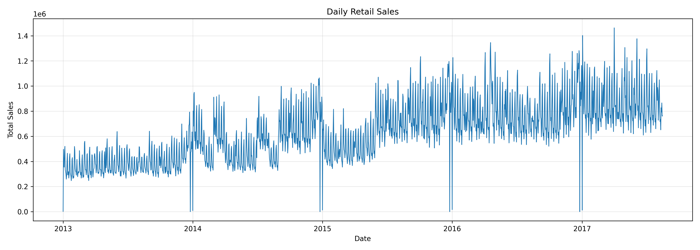
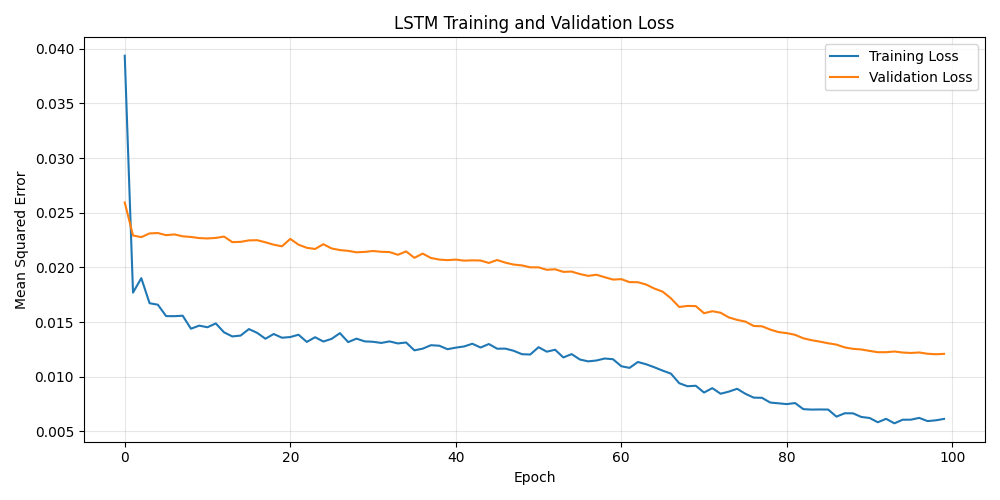
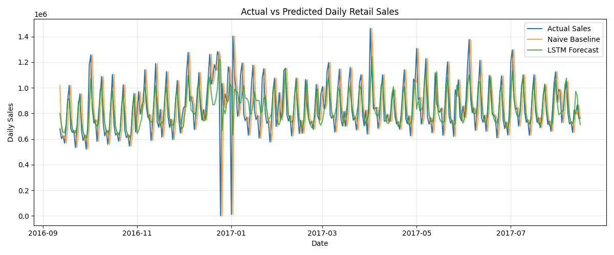

# Predictive Analytics on Retail Sales: Time Series Forecasting with LSTM

## 📌 Project Overview

This project explores historical retail sales data and aims to forecast future sales using **Long Short-Term Memory (LSTM)** neural networks, a type of recurrent neural network designed to learn patterns in sequential data.

The project uses the **Kaggle Store Sales – Time Series Forecasting** dataset, based on retail sales from Corporación Favorita in Ecuador. It follows a structured workflow, beginning with exploratory data analysis (EDA), followed by time series preparation, baseline forecasting, LSTM model development, and performance evaluation.

The EDA, data preprocessing, and initial LSTM modelling stages have been completed using Python, Pandas, NumPy, Matplotlib, Scikit-learn, and TensorFlow/Keras. The project includes six EDA visualisations, a prepared daily sales series, a naive baseline, an LSTM model, and test-period forecast comparisons.

The project is being developed as a practical learning and portfolio project in time series analysis, deep learning, and predictive analytics.

## 🎯 Objectives

- Explore historical retail sales data and identify trends and recurring patterns.
- Inspect dataset structure, data types, missing values, and data coverage.
- Analyse sales distributions and historical trends through visualisations.
- Investigate weekly sales patterns and compare sales across stores and product families.
- Explore the relationship between holiday/event dates and daily sales.
- Prepare time series data for forecasting without introducing data leakage.
- Establish a baseline forecasting approach for comparison.
- Develop and train an LSTM neural network to forecast future sales.
- Evaluate forecasting performance using appropriate regression metrics.
- Visualise actual and predicted sales and interpret the results.

## 📂 Dataset

The project uses the **Store Sales – Time Series Forecasting** dataset from Kaggle, based on retail sales data from Corporación Favorita in Ecuador.

The following dataset files have been collected for this project:

| File                  | Description                                                            |
| --------------------- | ---------------------------------------------------------------------- |
| `train.csv`           | Historical sales observations used for analysis and model development. |
| `stores.csv`          | Store metadata, including store characteristics and location.          |
| `oil.csv`             | Daily oil price information.                                           |
| `holidays_events.csv` | Holiday and event information that may be relevant to sales patterns.  |
| `transactions.csv`    | Daily transaction counts for individual stores.                        |

Additional competition files, such as `test.csv` and `sample_submission.csv`, may be incorporated later if needed for competition-style forecasting.

**Initial dataset overview**

The exploratory analysis of `train.csv` identified the following:

- **Rows:** 3,000,888
- **Columns:** 6
- **Date coverage:** 1 January 2013 – 15 August 2017
- **Unique stores:** 54
- **Product families:** 33
- **Missing values:** None found in the six columns examined

The columns are `id`, `date`, `store_nbr`, `family`, `sales`, and `onpromotion`.

**Important:** Raw CSV files are stored locally in the `datasets/` directory and excluded from Git tracking to keep the repository lightweight. Download the data from the [Kaggle competition data page](https://www.kaggle.com/competitions/store-sales-time-series-forecasting/data).

## 🛠️ Technology Stack

The project currently uses:

- **Python** — primary programming language.
- **Pandas** — data loading, manipulation, and analysis.
- **NumPy** — numerical computing.
- **Matplotlib** — data visualisation.
- **Jupyter Notebook** — interactive analysis and documentation.
- **Scikit-learn** — scaling, chronological modelling workflow support, and regression evaluation metrics.
- **TensorFlow/Keras** — LSTM model development and training.

## 🗺️ Project Workflow

The project is organised into five main tasks.

### Task 1: Project Setup & Exploratory Data Analysis — Completed

Established the project structure, loaded the dataset, inspected its structure and data quality, calculated descriptive statistics, and explored sales patterns through visualisations.

The analysis includes sales distribution, daily trends, weekly patterns, top-performing stores, top product families, and a preliminary comparison of holiday/event dates with other dates.

### Task 2: Data Preprocessing & Time Series Preparation — Completed

Converted the date column to datetime, checked data quality, aggregated sales across all stores and product families into one daily total, investigated four missing dates, and created a continuous daily series. The prepared dataset contains 1,688 daily observations and is saved to `outputs/processed/daily_sales.csv`.

The four missing dates are Christmas Days in 2013–2016. They are provisionally represented as zero sales based on the holiday-calendar evidence; these values were not observed in the original sales data and should be reconsidered during modelling.

The modelling workflow uses a 30-day lookback to predict the next day's sales. Data is split chronologically into a model-training period, validation period, and held-out test period. The reported test evaluation is rolling one-day-ahead forecasting rather than a single multi-day forecast made entirely in advance.

### Task 3: LSTM Model Development & Training — Completed

Created 30-day sequential input windows, established a rolling one-day-ahead naive baseline, and trained an LSTM model with 32 units, dropout, and early stopping. The model was trained using chronological training and validation periods.

### Task 4: Model Evaluation & Optimisation — Completed

Evaluated the LSTM on the held-out test period using MAE and RMSE. The LSTM performed better than the naive baseline on both metrics in this test setup. The comparison uses rolling one-day-ahead predictions, where the previous day's actual sales are available for the next prediction.

### Task 5: Results Visualisation & Project Delivery — In Progress

Saved the training/validation loss plot and actual-versus-predicted sales plot. Documentation and repository cleanup are being finalised. The provisional zero values for missing Christmas dates remain a limitation.

## 📊 Exploratory Data Analysis

The initial EDA was conducted in `notebooks/01_exploratory_data_analysis.ipynb`. The following visualisations were generated and saved in `outputs/figures/`.

### 1. Sales Distribution


The sales distribution is strongly right-skewed: the mean sales value is approximately **357.78**, while the median is **11**. This indicates that many observations have relatively low sales values, while a smaller number have much higher values. These observations should be investigated in context rather than automatically removed as outliers.

### 2. Daily Sales Trend


Daily aggregated sales show changes over time, including an overall upward pattern and noticeable fluctuations. These patterns motivate further investigation into long-term trends, calendar effects, and other variables that may be useful for forecasting.

### 3. Weekly Sales Patterns


The weekday comparison suggests that Saturday and Sunday have relatively high aggregated sales, while Thursday is lower in the current analysis. This is an initial pattern to investigate further during time series preparation.

### 4. Top-Performing Stores


The comparison of stores by cumulative sales highlights differences in total sales across locations. Store 44 is the leading store among the top stores shown in the analysis. These totals should be interpreted alongside the time period and available store-level data.

### 5. Top Product Families


GROCERY I, BEVERAGES, and PRODUCE are the leading product families by total sales in the initial analysis. This provides a starting point for investigating differences in sales behaviour across product categories.

### 6. Holiday and Event Sales Comparison


The preliminary comparison shows average daily sales of approximately **694,431** on dates marked as holidays or events, compared with approximately **627,548** on other dates.

This difference is descriptive, not evidence that holidays cause higher sales. The comparison groups dates using the available holiday/event calendar and does not, by itself, control for store closures, event types, seasonal trends, or other influences.

## 📈 Initial Findings

The completed EDA provides several useful starting points for the modelling stage:

- The training dataset contains more than three million observations, making efficient data handling important.
- No missing values were found in the six columns of `train.csv` during the initial inspection.
- Sales values are strongly right-skewed, so the distribution and high-value observations need careful consideration.
- Historical daily sales fluctuate and show an overall upward pattern.
- Sales differ across weekdays, stores, and product families.
- Daily sales on dates marked as holidays or events are higher on average in the preliminary comparison, but further analysis is needed before drawing stronger conclusions.

These findings guide the next stage of investigation. They do not yet establish which variables or modelling approach will produce the best forecasts.

## 🧹 Data Preprocessing & Time Series Preparation

The preprocessing work was carried out in `notebooks/02_data_preprocessing.ipynb`.

### Prepared Daily Sales Series

Sales were aggregated across all stores and product families to create one total sales value per calendar day. The series covers **1 January 2013 to 15 August 2017**.

- **Rows:** 1,688 daily observations
- **Columns:** `date`, `daily_sales`
- **Missing calendar dates found:** 4
- **Missing values after calendar completion:** 0
- **Duplicate dates:** 0
- **Chronological order:** Confirmed
- **Daily intervals:** Consistent

The four missing dates were 25 December 2013, 2014, 2015, and 2016. Each matched a national Christmas holiday in `holidays_events.csv`. These dates were provisionally filled with zero daily sales to create a continuous calendar. This is an assumption rather than an observed sales value, so it must be reviewed before final model training.

The exported CSV was reloaded and checked. Dates matched exactly, and sales values matched within floating-point tolerance.

### Prepared Daily Sales Plot



The plot provides a visual check of the prepared daily series, including its overall trend and day-to-day fluctuations. The zero-valued Christmas dates appear as sharp dips. These values should be interpreted in light of the documented assumption above rather than as directly recorded sales.

### LSTM Training and Validation Loss



The loss curves show the model's training and validation performance across epochs. The validation loss was used for early stopping and to restore the best model weights.

### Actual Sales vs Forecasts



This plot compares the actual test-period sales with the naive baseline and LSTM predictions. The sharp dips around Christmas reflect the provisional zero values in the prepared data.

## 📊 Model Evaluation

The LSTM uses the previous 30 days of daily sales to predict the next day's sales. A chronological split was used, with a validation period for monitoring training and a separate final test period for evaluation.

The test results are:

| Model          |        MAE |       RMSE |
| -------------- | ---------: | ---------: |
| Naive baseline | 165,347.39 | 227,751.17 |
| LSTM           |  93,248.46 | 148,042.64 |

On this test period, the LSTM reduced MAE by approximately **43.6%** and RMSE by approximately **35.0%** compared with the naive baseline.

- **MAE (Mean Absolute Error):** average absolute difference between actual and predicted sales.
- **RMSE (Root Mean Squared Error):** gives greater weight to larger prediction errors.
- **Baseline comparison:** checks whether the LSTM improves on a simpler forecasting approach.

These results apply to the chosen period and rolling one-day-ahead evaluation setup. They do not guarantee similar performance on other periods. The four zero-filled Christmas dates are an assumption and may affect training and evaluation.

## 📁 Project Structure

```text
retail-sales-lstm-forecasting/
├── datasets/
│   └── *.csv                         # Local raw datasets; excluded from Git
├── notebooks/
│   ├── 01_exploratory_data_analysis.ipynb
│   ├── 02_data_preprocessing.ipynb
│   └── 03_lstm_model_development.ipynb
├── outputs/
│   ├── processed/
│   │   └── daily_sales.csv
│   └── figures/
│       ├── 01_sales_distribution.png
│       ├── 02_daily_sales_trend.png
│       ├── 03_weekly_sales_patterns.png
│       ├── 04_top_stores.png
│       ├── 05_top_product_families.png
│       ├── 06_holiday_sales_comparison.png
│       ├── 07_daily_sales_plot.png
│       ├── 08_lstm_training_validation_loss.png
│       └── 09_actual_vs_predicted_sales.png
├── CHANGE_LOG.md
├── README.md
├── requirements.txt
└── SUMMARY.md
```

The `outputs/figures/` directory is tracked so the project's visualisations are available in the repository. Raw dataset files are excluded from Git tracking.

## ⚠️ Current Status

**Stage:** Tasks 1–4 completed; final project documentation and repository delivery being finalised.

- [x] Create the project repository.
- [x] Establish the project folder structure.
- [x] Collect the initial dataset files locally.
- [x] Load and inspect the training dataset.
- [x] Review data types, missing values, and date coverage.
- [x] Calculate descriptive sales statistics.
- [x] Generate and save six EDA visualisations.
- [x] Document initial findings and limitations.
- [x] Complete data preprocessing and time series preparation.
- [x] Create and validate a continuous daily sales series.
- [x] Save and verify `outputs/processed/daily_sales.csv`.
- [x] Define the one-day-ahead forecasting target and 30-day lookback.
- [x] Establish a naive baseline forecast.
- [x] Develop and train the LSTM model.
- [x] Evaluate and compare forecasting performance using MAE and RMSE.
- [x] Save the training-loss and forecast comparison figures.
- [x] Document the missing-Christmas-date assumption and evaluation limitation.
- [ ] Final repository review and Git commit.

## 🔮 Expected Outcome

The project demonstrates an end-to-end retail sales forecasting workflow, from EDA and daily time-series preparation to baseline forecasting, LSTM training, evaluation, and visualisation. In the current test period, the LSTM outperformed the naive baseline on both MAE and RMSE. The result should be interpreted in context: it uses rolling one-day-ahead predictions and the prepared series includes four provisionally zero-filled Christmas dates.

## 🔗 References

- [Kaggle: Store Sales – Time Series Forecasting](https://www.kaggle.com/competitions/store-sales-time-series-forecasting)
- [Kaggle: Competition Data](https://www.kaggle.com/competitions/store-sales-time-series-forecasting/data)
- [Pandas Documentation](https://pandas.pydata.org/docs/)
- [NumPy Documentation](https://numpy.org/doc/)
- [Matplotlib Documentation](https://matplotlib.org/stable/)
- [TensorFlow Documentation](https://www.tensorflow.org/)
- [Scikit-learn Documentation](https://scikit-learn.org/stable/)

---

_This project is being developed as a practical learning and portfolio project in time series analysis, deep learning, and predictive analytics._
